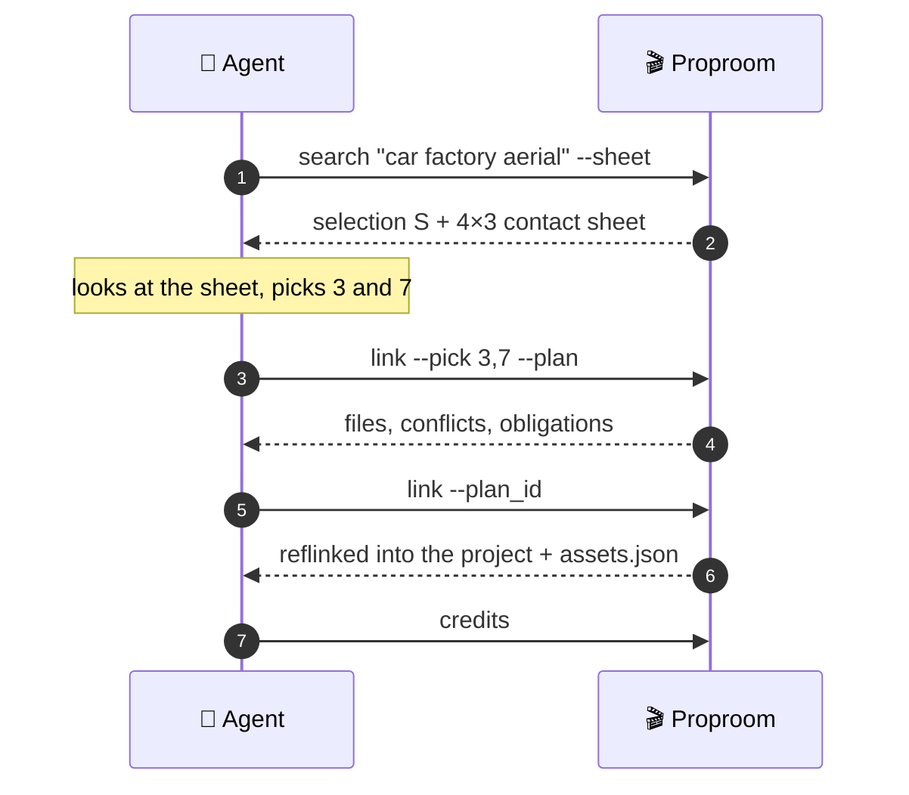

<div align="center">

# 🎬 Proproom

### The prop room for your AI agents.

**Your agent finds the footage, sees it, picks it, clears the rights, drops it into the project and writes the credits.**
<br>A self-hosted media library for open-licensed images, video and audio. **One container. One folder.**

[](LICENSE)


[Quick start](#-quick-start) · [Highlights](#-highlights) · [Agent workflow](#-a-day-in-the-life-of-an-agent) · [MCP](#-plug-it-into-your-agent) · [How it works](#-how-it-works) · [Docs](#-docs)

</div>

---

On a film set, every item in the prop room is numbered and logged with where it came from, and the prop master
pulls what the script calls for. **In Proproom, the prop master is your agent.**

> An agent that makes explainer videos needs real material every episode: portraits, title pages, aerials,
> parliaments, factories, archive film. Without help it **searches Commons from scratch** every time, **picks
> images by file name** because it can't see them, and someone **writes the credits by hand**. The same photos
> sit in four project folders and none of them can be searched.
>
> Proproom fixes all three.

## ✨ Highlights

<table>
<tr>
<td width="50%" valign="top">

### 👀 Agents that can *see*
`search --sheet` returns **one numbered 4×3 contact sheet**, not twelve full-size images. Tiles are letterboxed,
never centre-cropped, so heads, title pages and corner logos survive. Each tile shows the licence, resolution
and duration, plus its warnings in words (`⚠ watermark`, `used: <project>`). The agent answers *"3 and 7"*, and
the `selection_id` pins those numbers, so nothing is re-searched.

</td>
<td width="50%" valign="top">

### 🔎 Hybrid multimodal search
**EmbeddingGemma 2** puts text, images, video and audio in one vector space. It's fused with FTS5 keyword
search by **reciprocal rank fusion (RRF)**. Filters apply *during* recall, not after the top 12. A trigram index
handles Chinese, so `托克维尔` finds `托克维尔肖像`. `--explain` shows how each retriever ranked a result and
which fields it hit.

</td>
</tr>
<tr>
<td valign="top">

### ⚖️ Rights are first-class data
Every asset keeps its source, licence text and URL, and the basis for using it: `license`, `public_domain`
*with a stated reason*, `provider_license`, `quotation` or `own_work`. NC, ND, fair use and wire-agency photos
are denied by default. **Anything uncertain stays out of search until a person reviews it.** Plugins can make
the policy stricter, never looser.

</td>
<td valign="top">

### 📱 A person's opinion, when you want one
Most picks never need a person: the agent reads the contact sheet and links. When someone does want a say,
`prop share` turns a selection into a mobile-friendly page with no login: zoomable images, video segments that
loop between in and out points, and the licence and credit for each item. They tap **want / reject / ★** and
add a comment, and the agent reads the answers back with `share_feedback`.

</td>
</tr>
<tr>
<td valign="top">

### 📦 Delivery you can trust
`link --plan` is a **dry run**: it lists the files it will write, any conflicts, items the policy blocks, and
obligations such as *share-alike*. Then `link --plan_id` writes for real: temp file, manifest patch, **atomic
rename**, **reflink** where the filesystem supports it, every step journaled. If it's interrupted, the next boot
rolls the delivery back or finishes it.

</td>
<td valign="top">

### 📝 Credits, written for you
`prop credits <project>` produces the attribution block, grouped by use: open-licensed media, source pages shown
on screen, and data or base maps. Each line has title, author, source, licence with link, and what was changed.
The credits are built from the evidence recorded at delivery.

</td>
</tr>
<tr>
<td valign="top">

### 🎞️ Video-native
Scene detection cuts footage into **2–10 s segments**, and each segment can be found on its own. A segment
inherits its parent's text score, and no parent fills more than two slots in a result list. Delivery can record
a clip in the manifest only, or cut the file (`--cut fast` / `--cut exact`).

</td>
<td valign="top">

### 🧠 Automatic analysis
A background worker boxes **faces, plates, logos, text and the main subject** (YuNet + OWLv2). The boxes give
each asset a crop focus, blur boxes for bystanders' faces and number plates, and a `--fits 9:16` check for
Shorts. The worker also measures **loudness** and flags **watermarks and burned-in subtitles**.

</td>
</tr>
<tr>
<td valign="top">

### 🔌 Three entry points, one API
CLI, HTTP and **MCP** are all generated from a single operation registry with JSON schemas. You get
`idempotency_key` on every side effect, background jobs you can pause and resume, cursors, and structured errors
(`code`, `hint`, `retryable`).

</td>
<td valign="top">

### 🗄️ Zero-ops storage
**SQLite + sqlite-vec** in one folder on your NAS: no Postgres and no Redis. Blobs are **content-addressed and
immutable**: projects get a reflink or a copy, so editing a project never touches the library. `prop verify`
re-hashes the blobs to catch any byte that changed.

</td>
</tr>
</table>

## 🚀 Quick start

```bash
git clone https://github.com/lee813/Proproom.git && cd Proproom
```

```bash
PROP_NAS_PATH=/path/on/nas PROP_BIND=192.168.1.10 docker compose up -d --build
```

```bash
docker exec proproom prop capabilities
```

- `compose.yaml` reserves an NVIDIA GPU. Delete that block to run on CPU only.
- Page capture needs Chromium. Build with `--build-arg INSTALL_BROWSER=1`, or point `capture.cdp_url` at a
  Chromium service.
- On first start the library is created at `/nas/proproom/`. Set `home` in `/nas/.proproom.toml` or `PROP_HOME`
  to put it somewhere else. It contains `db.sqlite`, `blobs/ thumbs/ models/ plugins/ tmp/ journal/ backups/`, a
  commented `config.toml` and `instance.token`, the token for the management API.

## 🎬 A day in the life of an agent

```bash
# 1. Look in the library first, and get a numbered contact sheet back
prop search "oil tanker in a canal" --k 12 --sheet

# 2. Nothing good? Search a remote source, then fetch the picks
#    (fetch resolves the item, checks rights, then downloads)
prop remote commons "Tocqueville portrait" --sheet
prop fetch --selection_id S1 --pick '[2]'

# 3. The agent picks from the sheet. Dry-run the delivery, then deliver
prop link --project project/Episode12 --selection_id S1 --pick '[3,7]' --plan
prop link --plan_id P1

# 4. Write the credits
prop credits project/Episode12
```

Want a person to look before delivery? Optional: `prop share --selection_id S1`, then `prop share_feedback
<token>` reads back their picks. Bulk restocking runs as a background job you can pause:
`prop pull pull.yaml --budget 1G`.



## 🤖 Plug it into your agent

**MCP** (stdio). The default tool set is deliberately small: `search`, `remote`, `fetch`, `link`, `credits`,
`share`, `share_feedback`, `job` and `capabilities`. Results come back as `structuredContent`, and contact
sheets as image content.

```json
{
  "mcpServers": {
    "proproom": {
      "command": "docker",
      "args": ["exec", "-i", "proproom", "prop", "mcp"]
    }
  }
}
```

Add `--admin` for the maintenance tools: `verify`, `import_project`, the `plugin_*` tools and so on.

**HTTP**: the same operations at `POST /v1/ops/{name}`.

```bash
curl -H "Authorization: Bearer $(cat /path/on/nas/proproom/instance.token)" \
     -d '{"query": "parliament chamber", "sheet": true}' \
     http://nas:8765/v1/ops/search
```

[`docs/agents.md`](docs/agents.md) is the cheat sheet for agents: commands, schemas, error codes and the
recommended flow.

## 🧭 How it works

```mermaid
flowchart LR
    subgraph Sources
      C[Wikimedia Commons]
      W[Wikidata]
      I[Internet Archive]
      K[Page capture]
    end
    Sources -->|resolve → rights check → download| F[fetch]
    F --> B[(Immutable blobs<br/>+ SQLite)]
    B --> WK[Worker<br/>regions · scenes · loudness · OCR]
    WK --> IX[Index<br/>EmbeddingGemma 2 + FTS5]
    IX --> S[search --sheet]
    S --> L[link --plan → link]
    S -.->|optional| SH[share → 📱]
    SH -.-> L
    L --> PR[📁 project/<br/>files + assets.json]
    PR --> CR[credits]
```



- **The core enforces; plugins suggest.** Plugins return structured results only. The core does every write,
  download, file operation and event. A plugin that raises counts as a deny.
- **Every side effect can be retried.** Each one has an idempotency key, a journal and an explicit end state.
- **Results explain themselves.** Every flag and every rights decision points to the evidence behind it.
- **Plugin types:** `source`, `analyzer`, `segmenter`, `embedder`, `exporter`. See [`docs/plugins.md`](docs/plugins.md).

## 🆚 Why not just…

| | Local library | Video segments | Rights & credits | Delivery to projects | Agent-native |
|---|:---:|:---:|:---:|:---:|:---:|
| **Proproom** | ✅ | ✅ | ✅ | ✅ | ✅ |
| Commons search MCP servers | ❌ stateless | ❌ | — | ❌ | ✅ |
| Single-source MCP servers (Openverse, Pexels) | ❌ nothing stored | — | ❌ no credits | — | ✅ |
| `rclip` | ✅ images only | ❌ | ❌ | — | CLI |
| Immich / PhotoPrism | ✅ own import | — | ❌ | — | ❌ built for people |

<sub>— means not compared. Based on each project's public description as of 2026-10-31.</sub>

## 🖥️ Hardware

| Tier | Target | Status |
|---|---|---|
| **NVIDIA** | Turing (sm_75) or newer, 4 GB VRAM; fp16 on Turing, bf16 on Ampere+ | ✅ Verified on an RTX A6000. Fits in 4 GB by measurement (below); not yet run on a real 4 GB card |
| **Intel** | 11th-gen Core / Xe iGPU, N100 / N305, Arc, via OpenVINO | 🚧 Planned, not yet verified |
| **CPU** | any x86-64 or arm64 | 🚧 Planned, not yet verified |

**GPU memory, measured** on the A6000 with a real library's media (the largest photo, clips from 14 s to 42 min,
then OWLv2 on top), EmbeddingGemma 2 in bf16:

| | Memory |
|---|---|
| Model weights | 1.40 GiB |
| Peak while embedding photos and video | 2.51 GiB |
| Whole process, CUDA context included, with PyTorch capped at 3.2 GiB (what a 4 GB card leaves) | 3.4 GB |

That leaves about 0.6 GB on a 4 GB card, so the container keeps **one copy of each model**: `prop` and the MCP
server send their calls to the running propd instead of loading their own, and a model unused for
`embedding.idle_unload_s` (600 s) is released. If the container loses access to the GPU, propd exits instead of
falling back to the CPU, and Docker restarts it.

`prop capabilities` reports what was detected. Throughput is published here only once it has been measured.

## 🗺️ Roadmap

- [x] Content-addressed store, rights engine, provenance and evidence
- [x] Hybrid search, contact sheets, share pages, delivery, credits
- [x] Sources: Wikimedia Commons, Wikidata, Internet Archive, page capture
- [x] Worker: region detection, scene segmentation, loudness, OCR flags
- [x] Crash recovery, `verify`, `repair`, `eval` (recall@k / nDCG on your own queries)
- [ ] Prebuilt images on GHCR (`:latest-cuda`, `:latest-intel`, `:latest-cpu`)
- [ ] Intel / OpenVINO and CPU tiers, with measured throughput
- [ ] Watermark detection based on embedding similarity, alongside OCR
- [ ] Plugin contract runner (`prop plugin_test`)

## 🌐 Page capture

Capture saves a source page as a screenshot plus an MHTML snapshot, for example a press release you quote on
screen. It only visits hosts on an allowlist in the library's `config.toml`:

```toml
[capture]
allowed_domains = ["www.example.org", "static.example.org"]
cdp_url = "http://browser-service:9222"   # optional: an existing Chromium service
```

```bash
prop remote capture https://www.example.org/press-release
prop fetch --source capture --external-id https://www.example.org/press-release \
  --options '{"viewport_width":430,"viewport_height":900,"device_scale_factor":2,"scroll_text":"Results"}'
```

The options `scroll_y`, `clip` and `highlight` take CSS pixels. Capture keeps the requested and final URLs, the
page title and the publisher.
- Pages without a recognised open licence are recorded as quotations, for review.
- Every navigation host and resource host must be on the allowlist, redirect targets included.
- Frames and WebSockets are disabled.
- Capture runs in an isolated browser context and never signs in.

## 📚 Docs

| | |
|---|---|
| [`docs/agents.md`](docs/agents.md) | Commands, schemas, error codes and the recommended flow |
| [`docs/plugins.md`](docs/plugins.md) | Writing a plugin |
| [`docs/sources.md`](docs/sources.md) | Each source's terms, with the date they were checked |
| [`docs/errors.md`](docs/errors.md) | Error codes |
| [`docs/HANDOVER.md`](docs/HANDOVER.md) | The full design (in Chinese) |

**Requirements:** SQLite ≥ 3.37 (STRICT tables) with FTS5 trigram, and sqlite-vec ≥ 0.1.6 (0.1.9 is pinned).
The CUDA image ships SQLite 3.45.1.

## ⚠️ Responsibility, terms, trust

- Rights evidence comes from each source. Proproom records it, enforces the policy you configure and points out
  obligations; it gives no legal advice and the final call is yours.
- Respect every site's terms and rate limits. Sources that need API keys are enabled only when you add your key
  to `keys.toml`.
- Plugins are arbitrary code running in the container — trust them like `pip install`. The SDK boundaries prevent
  mistakes, not malice. `prop plugin_list` shows each plugin's hash.
- `-p 8765:8765` listens on every interface. Never forward it to the internet; bind to the LAN IP
  (`-p <LAN-IP>:8765:8765`) or put a reverse proxy with HTTPS / Tailscale in front.

## 📄 License

[MIT](LICENSE). No media, model weights or keys are ever committed.
